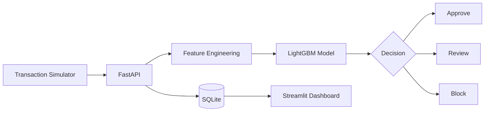
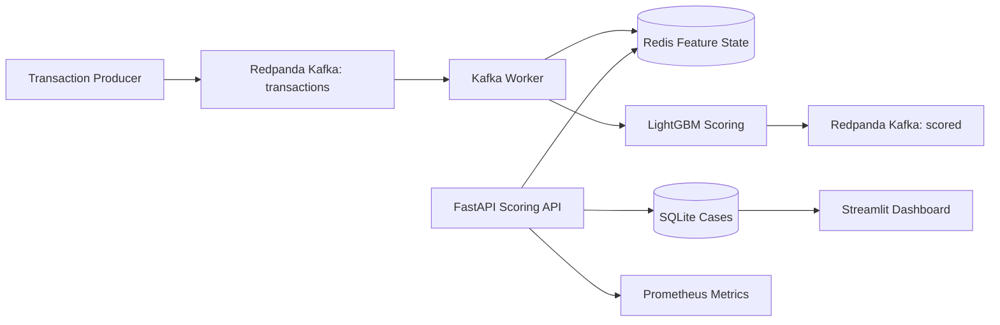

# AIML-01 Architecture

## 1. Prototype HTTP Scoring Flow

## 2. Production Demo Streaming Flow

## Key Design Choices

- Point-in-time feature engineering helps prevent future-data leakage.
- Time-based split: 60% training, 20% validation, 20% testing.
- Fraud is highly imbalanced, so PR-AUC, precision and recall are important metrics.
- Review and block thresholds use assumed business costs.
- Fraud-ring detection links accounts through shared devices in flagged transactions.
- LightGBM feature contributions help explain flagged transactions.

## Infrastructure

- FastAPI: authenticated HTTP scoring API.
- LightGBM: fraud classification model.
- Redis: shared feature state and scoring state.
- Redpanda: Kafka-compatible transaction streaming.
- Kafka Worker: consumes transactions and publishes scoring results.
- SQLite: demo case storage.
- Streamlit: analyst dashboard.
- Prometheus: application metrics endpoint.

## Limitations

- Experiments use synthetic transaction data with planted fraud patterns.
- Metrics do not represent real-world banking performance.
- Production use requires real data, security review, load testing and managed infrastructure.
