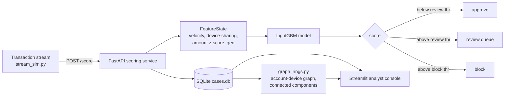

# Architecture

## Key design choices
- **One feature class, two uses:** `FeatureState` builds training data by replaying history in time order and scores live traffic, so there is no train/serve skew.
- **Time split:** first 60% train, next 20% validation (picks the threshold), last 20% test.
- **Imbalance:** fraud is under 1% of rows. Judge with PR-AUC, precision and recall, not accuracy.
- **Threshold by cost:** a missed fraud costs its amount, a review costs a fixed amount (`REVIEW_COST` in train_model.py, an assumption you should justify or change).
- **Rings:** accounts linked through shared devices in *flagged* transactions only. Components with 3 or more accounts are candidate rings.
- **Explanations:** top positive LightGBM contributions per flagged transaction are shown to analysts.
